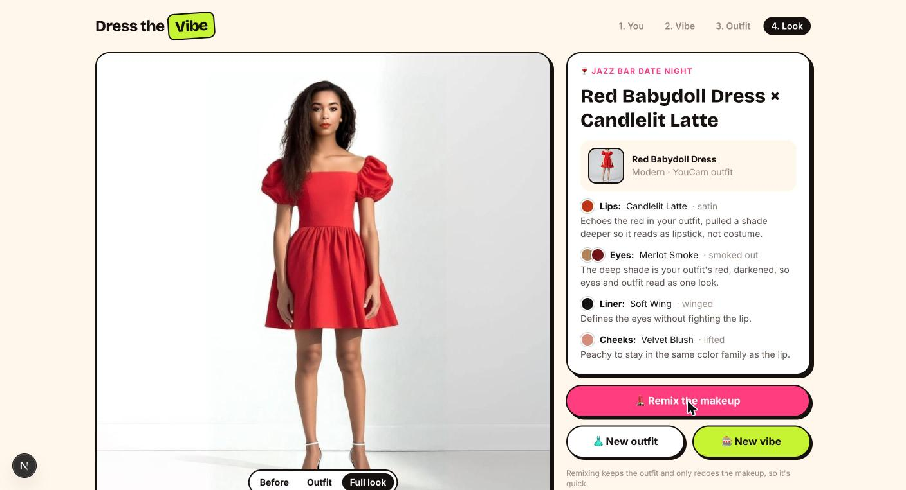

# Dress the Vibe

**Tell us the vibe. We'll dress you for it: outfit and makeup, together, on you.**

Getting ready is one decision, but shopping treats it as two: clothes in one app, makeup in another, and you guess whether they go together. Dress the Vibe styles the *whole look* at once.

1. **You.** Upload a full-body photo (or use a sample model).
2. **The vibe.** Pick one of 8 vibes, type your plans ("first date at a wine bar"), or spin the vibe slot machine.
3. **The outfit.** A rack of outfits picked for that vibe from YouCam's outfit catalog. Before anything runs, you see the **look recipe**: the exact lip, eye, liner and blush shades, and *why* each one goes with that outfit.
4. **The look.** YouCam puts the outfit on you, then does your makeup to match, in one photo. Compare Before / Outfit / Full look, remix the makeup, or try another outfit.



## How the two try-ons work as one

```
your photo ─► YouCam AI Clothes (template try-on) ─► outfit photo
                                                        │
              browser face finder (MediaPipe, tiled) ◄──┘
                     │ crop + enlarge the face
                     ▼
              YouCam Makeup VTO (recipe from the stylist) ─► made-up face
                     │ feathered oval blend back into the outfit photo
                     ▼
                 the full look
```

- **Makeup on a full-body photo.** Makeup VTO needs a clear face, and in a full-body shot the face is tiny (YouCam returns `error_no_face`). So the app finds the face in the browser by scanning the image in tiles, crops and enlarges it, runs Makeup VTO on the crop, and blends the result back with a soft oval mask. You get one seamless image. If the face can't be found, you tap on it instead.
- **The stylist matches makeup to the outfit.** Each of the 218 outfits has its garment colors pre-extracted (background and skin filtered out). The stylist (`src/lib/stylist.ts`) applies classic color rules:
  - a warm statement color (red, coral, pink) is *echoed* on the lips, pulled deeper so it reads as lipstick;
  - a cool outfit gets the vibe's signature lip so it pops;
  - an all-neutral outfit makes the lip the statement piece;
  - the eyeshadow's deep shade is the outfit color darkened, and blush stays in the lip's color family.
  Every choice comes with a one-line reason.
- **Vibes are styling briefs.** Each sets which outfit categories fit, makeup intensity, liner style (none, tight, wing, graphic double, smudged), shadow placement and blush shape. Wedding guests never get white outfits.
- **Remix is cheap.** The outfit result is cached, so "Remix the makeup" only re-runs Makeup VTO with a shifted palette.

## YouCam APIs used

| API | Endpoint | Used for |
|---|---|---|
| File upload | `POST /s2s/v2.0/file` + signed `PUT` | user photo, face crop |
| AI Clothes templates | `GET /s2s/v2.0/task/template/cloth` | building the outfit catalog (`src/data/outfits.json`) |
| AI Clothes try-on | `POST /s2s/v2.0/task/cloth` with `template_id` | putting the outfit on you |
| Makeup VTO | `POST /s2s/v2.0/task/makeup-vto` (`lip_color`, `eye_shadow`, `eye_liner`, `blush`) | the matched makeup |

Pattern names (e.g. `OpenWings3`, `2colors4`, `Oblique1`) come from YouCam's published pattern catalogs.

## Run it

```bash
npm install
cp .env.example .env.local   # add YOUCAM_API_KEY
npm run dev                  # http://localhost:3000
```

`TRYONS_PER_IP_PER_DAY` and `TRYONS_PER_DAY` set soft daily caps for a public deployment.

## Tech

Next.js 16 · TypeScript · Tailwind CSS 4 · YouCam AI API · MediaPipe Face Detector (runs in the browser, model served locally).

Outfit images and templates belong to Perfect Corp / YouCam and are used through their API.
